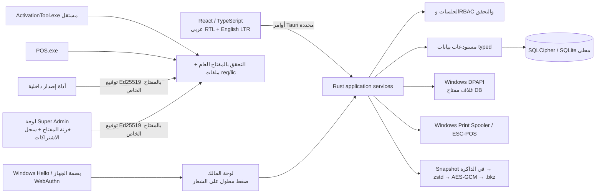

# المعمارية والقرارات التقنية

## نظرة عامة

لا يوجد backend شبكي. كل قراءة وكتابة تشغيلية تتم في العملية المحلية على جهاز المحل. يُستعمل الاتصال بالشبكة فقط إذا اختار المالك خدمة خارجية اختيارية لاحقًا، ولا يدخل ذلك في مسار البيع أو التفعيل الأوفلاين.

## حزم التطبيق

### 1) `apps/pos-desktop`

- تطبيق Tauri مستقل بـ React/TypeScript؛ Rust هو الحد الأمني الوحيد للوصول إلى قاعدة البيانات والملفات والطابعات.
- الواجهة لا تنفذ SQL ولا تخزن أسعار التكلفة ولا تتلقى بيانات غير مصرح بها.
- أوامر Tauri مسماة ومحدودة مثل `login`, `get_catalog`, `create_sale`, `record_return`, `create_backup`, `restore_backup`. كل أمر يعيد التحقق من الجلسة والصلاحية في Rust؛ إخفاء زر في React ليس صلاحية.
- عملية البيع تبدأ `BEGIN IMMEDIATE`، تتحقق من الأرصدة والصلاحيات والدفعات، ثم تحفظ الفاتورة والبنود والمدفوعات وحركات المخزون وسجل التدقيق في معاملة واحدة. أي فشل قبل `COMMIT` يلغي العملية كلها.
- ترقيم الفاتورة داخل جدول sequence في المعاملة. مفتاح idempotency فريد يمنع إنشاء فاتورتين بسبب تكرار النقر/IPC.
- الطباعة بعد نجاح الحفظ لا داخل المعاملة. فشل الطابعة لا يلغي البيع؛ يُسجل job بحالة `PENDING/FAILED` ويُتاح إعادة الطباعة دون إعادة خصم المخزون.

### 1.1) لوحة تحكم المالك داخل `apps/pos-desktop`

- جزء من تطبيق العميل، لكنها **سطح منفصل**: تُفتح بالضغط المطول على الشعار، ولها جلسة خاصة (`owner_sessions`) لا تختلط بجلسات البيع.
- الأوامر: `owner_panel_status`, `owner_panel_unlock_with_password`, `owner_panel_begin_assertion`, `owner_panel_finish_assertion`, `owner_panel_begin_registration`, `owner_panel_finish_registration`, `owner_panel_credentials`, `owner_panel_revoke_credential`, `owner_panel_overview`, `owner_panel_set_return_policy`, `owner_panel_set_tax`, `owner_panel_lock`.
- التحقق من بصمة الجهاز يتم في Rust: مراسم WebAuthn تُقرأ من `src/webauthn.rs`، والمستند CBOR يُقرأ بقارئ صغير في `src/cbor.rs`، والتوقيع يُتحقق من ES256 مقابل المفتاح العام المخزَّن في `owner_panel_credentials`.
- ما يضبطه المالك من اللوحة هو نفسه ما يطبّقه مكتب المرتجعات: `returns_policy` في `system_settings`، والضريبة في `branches`.

### 2) قاعدة البيانات والـ ORM

الاختيار المقترح: SQLCipher 4.x مع `rusqlite` وطبقة repositories مكتوبة بأنواع Rust واضحة، ومهاجرات SQL مرقّمة ذات checksum. لن نستخدم `tauri-plugin-sql` أو Drizzle في الواجهة؛ لا نمرر اتصال قاعدة البيانات للـ WebView. السبب أن تنفيذ SQLCipher يجب أن يكون native ومؤكدًا، وأن كلمة `SQLite` وحدها لا تعني تشفيرًا. إصدار `rusqlite` الحالي يدعم feature `bundled-sqlcipher-vendored-openssl`، ويُبنى معه SQLCipher بدل الاعتماد على DLL غير معروف على جهاز المتجر. هذا خيار persistence typed/متحقق في الخلفية، لا ادعاء بأنه ORM ActiveRecord.

نثبت نسخة SQLCipher الفعلية في CI بإخراج `PRAGMA cipher_version` و`sqlite_version()`، ونفشل بدء البرنامج إذا كان الملف أو المحرك غير مشفر. لا يكفي نجاح `PRAGMA key`: يجرى استعلام schema بعد تهيئة المفتاح ويفحص `cipher_version` و`cipher_status` حيث يدعمها الإصدار.

### 3) حدود الفروع

- `branches` يُنشأ بسجل واحد عند التهيئة.
- كل سجل تشغيلي خاص بالفرع يحمل `branch_id`، والقيود الفريدة تكون عادة `(branch_id, business_key)`.
- لا توجد مزامنة أو تقسيم مخزون لفروع في النسخة الأولى. إضافة فروع مستقبلًا تتطلب مزامنة ومعالجة تعارضات، وليست مجرد إظهار selector.

## تدفق نقطة البيع

1. البحث بالباركود أولاً exact، ثم SKU/اسم الصنف. إدخال الماسح USB Keyboard-Wedge يرسل النص كلوحة مفاتيح؛ لا يعتمد البحث على الإنترنت.
2. تُختار تركيبة SKU محددة: المنتج + المقاس + اللون. لا يوجد بيع على رصيد مستوى المنتج فقط.
3. يعرض Rust سعر البيع الحالي والرصيد المسموح للمستخدم، ويعيد التحقق عند checkout.
4. تُدخل الخصومات المصرح بها. الخصم اليدوي فوق حد المحل يحتاج صلاحية/سببًا وموافقة بحسب القرار النهائي.
5. يمكن توزيع المبلغ على عدة طرق دفع. مجموع الوسائل يجب أن يساوي إجمالي الفاتورة بالقرش المصري.
6. تحفظ المعاملة البيع والدفع والمخزون والتدقيق. بعد ذلك فقط تنفذ الطباعة/إعادة الطباعة.

## المال والضريبة

- لا تستخدم floating point. كل مبلغ `INTEGER` بوحدة القرش (minor units) مع العملة `EGP`.
- تستخدم ضريبة أساسها basis points (14% = 1400) وقاعدة السعر شامل/غير شامل كإعداد فرع.
- تقريب الضريبة إلى أصغر وحدة نقدية يكون واضحًا ومختبرًا. يلزم اعتماد ما إذا كانت أسعار الرف شاملة للضريبة قبل الإنتاج.
- تحفظ الفاتورة snapshots للاسم/المقاس/اللون والسعر والضريبة والتكلفة وقت البيع، حتى لا تتغير الفاتورة التاريخية عند تعديل المنتج.

## واجهة Windows والطابعات

- واجهة لمس/ماوس سريعة مع focus افتراضي على حقل الباركود، اختصارات لوحة مفاتيح، وRTL/LTR حقيقي.
- طابعة 58 أو 80mm تُعرف كطابعة Windows. تُختبر أوامر ESC/POS/قص الورق/درج النقد مع الموديل الفعلي. وضع HTML/driver بديل إن لم يدعم الجهاز ESC/POS.
- ملصق الباركود يطبع الاسم والمقاس واللون والسعر وCode 128 أو الباركود الأصلي؛ حجم الملصق والطابعة قرار جهاز.
- شاشة العميل نافذة محلية اختيارية؛ لا تؤثر على البيع إن غابت.

## الاعتمادية والنسخ الاحتياطي

- WAL، `synchronous=FULL` للمعاملات الحرجة، و`foreign_keys=ON`. تُجرى فحوص `integrity_check`/`foreign_key_check` بعد الاستعادة.
- يمنع إطفاء الجهاز القسري من ضمان آخر بايت مكتوب، لذلك توجد نسخة تلقائية يومية واختبار استعادة دوري.
- النسخ يلتقط DB + الصور المحلية + إعدادات الطباعة الضرورية، ويرفق schema version وmanifest وhash. يكتب `.part` مشفرًا ثم يعاد تسميته ذريًا بعد تحقق المصادقة والترويسة.

## قائمة الحزم المقترحة عند التثبيت (10 أكتوبر 2026)

| المكوّن | الإصدار المقترح | سبب/ملاحظة |
|---|---:|---|
| Tauri runtime/CLI | `2.12.x` | فرع 2 المستقر؛ تجنب 3 alpha |
| `@tauri-apps/api` | `2.12.1` | واجهة JS متوافقة مع Tauri 2 |
| React / React DOM | `19.3.0` | إصدار React مستقر معلن رسميًا |
| Vite | `8.3.2` | يتطلب Node `20.19+` أو `22.12+` |
| TypeScript | `6.0.3` | تثبيت إصدار مستقر؛ حُدد `strict` صراحةً |
| `rusqlite` | `0.40.2` | يدعم SQLCipher المضمّن؛ فعّل `bundled-sqlcipher-vendored-openssl` و`backup` |
| SQLCipher المضمّن | `4.14.0` أو أحدث patch مجرب ضمن 4.x | يتضمن baseline SQLite 3.51.3 وإصلاح WAL-reset المذكور في release notes؛ لا تستخدم SQLCipher 5 beta |
| `argon2` | `0.6.x` | Argon2id لكلمات المرور؛ تثبيت PHC parameters واختبارها على جهاز المحل |
| `ed25519-dalek` | `3.0.x` | توقيع/تحقق Ed25519؛ private key في issuer فقط |
| `serde`, `serde_json`, `uuid`, `chrono`, `zeroize`, `zstd`, `aes-gcm`, `csv`, `calamine` | إصدارات stable وقت التنفيذ مع `Cargo.lock` | JSON/IDs/وقت/مسح ذاكرة/ضغط/backup/import |

هذه أرقام أساس مقترحة، وليست وعدًا أن كل patch متوافقة تلقائيًا. يُقفل `Cargo.lock` و`package-lock.json` بعد build نظيف على Windows، ويُشغّل تدقيق التبعيات وSBOM قبل الإصدار. يعتمد بناء SQLCipher على feature واحد فقط لتجنب duplicate `libsqlite3-sys`/native link.

## مراجع الإصدار

- Tauri 2.12.0 [سجل الإصدارات](https://v2.tauri.app/release/tauri/) و[إعلان Tauri 2.12](https://v2.tauri.app/blog/tauri-2.12/).
- React 19.3 [الإعلان الرسمي](https://react.dev/blog/2026/09/09/react-19-3).
- Vite 8 [إعلان الإصدار ومتطلبات Node](https://vite.dev/blog/announcing-vite8) و[حزمة Vite](https://www.npmjs.com/package/vite).
- `rusqlite` 0.40.2 [الإصدار والميزات](https://docs.rs/crate/rusqlite/latest/features)؛ يذكر changelog تحديث SQLCipher المضمّن إلى 4.14.0 [الإصدار](https://github.com/rusqlite/rusqlite/releases).
- SQLCipher 4.14 [ملاحظات الإصدار](https://www.zetetic.net/blog/2026/03/17/sqlcipher-4.14.0-release/).
- Windows DPAPI [CryptProtectData](https://learn.microsoft.com/en-us/windows/win32/api/dpapi/nf-dpapi-cryptprotectdata).
