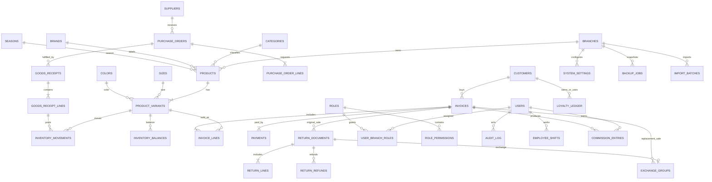

# ERD ومخطط البيانات

## العلاقات

## الجداول والقيود المحورية

كل جداول المعاملات/الكتالوج/المخزون تحمل `branch_id`؛ الجداول العامة مثل `roles` و`permissions` لا تحتاجه. المبالغ أعداد صحيحة `*_minor` (EGP piasters)، والوقت UTC ISO-8601، والمعرّفات UUID نصية.

### الفرع والهوية

- `branches`: إعداد العملة والضريبة وشمول السعر واللغة/المنطقة ومعلومات الفرع.
- `users`: username فريد و`password_phc` من Argon2id، حالة نشطة.
- `roles`, `permissions`, `role_permissions`: تعريف RBAC.
- `user_branch_roles`: grant مستخدم/دور على فرع؛ يسمح بأدوار متعددة مستقبلًا.
- `employees`, `employee_shifts`, `sales_commission_rules`, `commission_entries`: بيانات موظف ودوام اختياري وعمولة قابلة للضبط. الكاشير لا يقرأ تكلفة/ربح/عمولة.

### الكتالوج والمتغيرات

- `categories`, `brands`, `seasons`: قوائم الفرع؛ أسماء عربية/إنجليزية.
- `products`: الاسم/الوصف والوصف المحلي للصورة، الفئة والعلامة والموسم، سعر أساس وتكلفة أساس، active/archive.
- `sizes`: جدول مقاسات قابل للتهيئة (XS–XXL كخط بداية، ويمكن فئة أطفال/One size/أحذية).
- `colors`: اسم عربي/إنجليزي وcolor code.
- `product_variants`: SKU مستقل لكل (product, size, color)، باركود، سعر/تكلفة override اختياري، `reorder_level` مستقل وactive.
- قيود: `UNIQUE(branch_id, sku)`, `UNIQUE(branch_id, barcode)` (NULL مسموح قبل توليد باركود)، و`UNIQUE(product_id, size_id, color_id)`؛ للمتغيرات التي لا تملك لونًا يُستخدم لون «بدون لون» بدل NULL لتفادي كسر uniqueness.
- `product_images`: ملف محلي داخل مجلد media مع MIME/sha256؛ لا مسار شبكي.

### المخزون والمشتريات

- `inventory_balances`: projection لكل `(branch_id, variant_id, bucket)`؛ bucket من `SELLABLE`, `DAMAGED`, `QUARANTINE`. البيع يخصم SELLABLE فقط.
- `inventory_movements`: دفتر append-only، النوع/الكمية الموقعة/تكلفة اللقطة/السبب/source/actor/operation UUID/idempotency key. كل حركات الاستلام/البيع/المرتجع/الجرد تُربط بمصدرها.
- `stock_counts`, `stock_count_lines`: جلسة جرد ورصيد متوقع ومعدود وفرق؛ الفرق ينشئ حركة لا overwrite.
- `suppliers`: بيانات مورد، بيانات اتصال/عنوان مشفرة أو مشفّرة على مستوى DB.
- `purchase_orders`, `purchase_order_lines`: أمر شراء، SKU، كمية مطلوبة/مستلمة، cost snapshot.
- `goods_receipts`, `goods_receipt_lines`: استلام جزئي/كامل؛ كل سطر ينشئ حركة مخزون بنفس transaction.

### المبيعات والمدفوعات

- `invoices`: رقم فرع فريد، مفتاح idempotency، كاشير/عميل اختياري، وقت وحالة، snapshot totals/subtotal/discount/tax، branch tax basis.
- `invoice_lines`: variant، qty، سعر/تكلفة snapshot، الخصم والضريبة، الاسم/المقاس/اللون كما طُبع وقتها. ممنوع تعديل/حذف سطر فاتورة معتمدة؛ التصحيح بعكس/مرتجع.
- `payments`: عدة صفوف لكل فاتورة؛ `CASH`, `CARD`, `WALLET`, `STORE_CREDIT`، كل مبلغ موجب، مرجع دفع مشفر عند الحاجة. لا يخزن PAN/CVV.
- `cash_shifts`, `cash_drawer_movements`: اختيارية في MVP، لتسوية الصندوق والوردية.
- `print_jobs`: فاتورة/قالب/عرض 58 أو 80mm/حالة الطباعة ومحاولات. الطباعة لا تدخل في transaction البيع.

### العملاء والولاء

- `customers`: اسم/هاتف/ملاحظات/تفضيلات مشفرة؛ `phone_lookup_hmac` للبحث exact؛ consent/created_at.
- `loyalty_ledger`: نقاط موقعة event-based `EARN/REDEEM/ADJUST/EXPIRE`, سبب/فاتورة؛ الرصيد يُجمع من الدفتر.

### المرتجعات والاستبدالات

- `return_documents`: فاتورة أصلية إلزامية، نوع `RETURN/EXCHANGE`, سبب/فاعل/حالة/إجمالي مسترد، فاتورة استبدال اختيارية.
- `return_lines`: invoice line أصلية، SKU وqty، reason، condition `UNOPENED/NEW_TAGS/WORN/DAMAGED`, disposition `RESTOCK/DAMAGED/QUARANTINE/DISCARD`, قيمة رد snapshot.
- `return_refunds`: مبلغ/وسيلة رد؛ يسجل خروج النقد/رد البطاقة/المحفظة، لا يتجاوز المبلغ المؤهل.
- `exchange_groups`: ربط return document بفاتورة الاستبدال وفرق السعر والتسوية. بيع البديل فاتورة جديدة؛ الفرق الموجب يدفع، والسالب يعاد وفق السياسة.
- حركة المخزون موجبة إلى `SELLABLE` فقط للقطعة التي سمح فحصها؛ القطعة غير الصالحة تسجل في bucket غير قابل للبيع أو تُشطب.

### التدقيق والإعدادات والنسخ والاستيراد

- `audit_log`: actor/branch/time/action/entity/reason و`prev_hash`/`event_hash`; append-only، لا PII في details.
- `system_settings`: إعدادات فرع versioned؛ سياسة الخصم والضريبة والمرتجعات وساعة القفل.
- `backup_jobs`: نتيجة/وقت/إصدار schema/حجم/checksum/وجهة منقحة؛ لا يخزن مفاتيح أو كلمات مرور.
- `import_batches`, `import_rows`: مصدر/checksum، مراجع الصفوف وحالتها/أخطاء التحقق قبل الاعتماد.
- `schema_migrations`: version/checksum/time.

## ملف SQL

`apps/pos-desktop/src-tauri/migrations/0001_initial.sql` هو تعريف أولي قابل للتطبيق. يجب تشغيله في transaction بعد فتح اتصال SQLCipher بمفتاح صحيح. جميع القيود المهمة مذكورة أيضًا هنا كي يكون ERD قابلًا للمراجعة. 

## قواعد النزاهة

1. لا يوجد `products.stock_qty` إجمالي بديل عن `product_variants`؛ الرصيد دومًا SKU/مقاس/لون/فرع.
2. الرصيد الفعلي المستمد من حركات دفترية، لا من edits صامتة.
3. أسعار الفاتورة والضريبة والتكلفة لقطات immutable وقت البيع.
4. المفاتيح الفريدة/idempotency ومعاملات SQLite تمنع بيع/حركة مكررة.
5. FK وCHECK وUNIQUE تدعم تحقق البرنامج؛ API يفحص الصلاحية والحالة قبل الإدخال.
